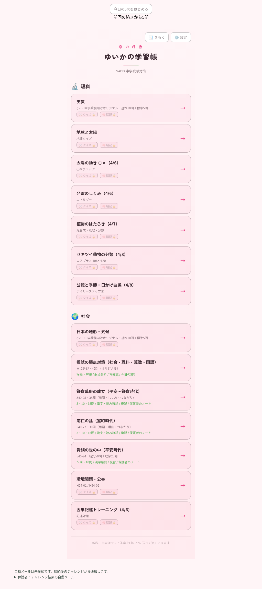
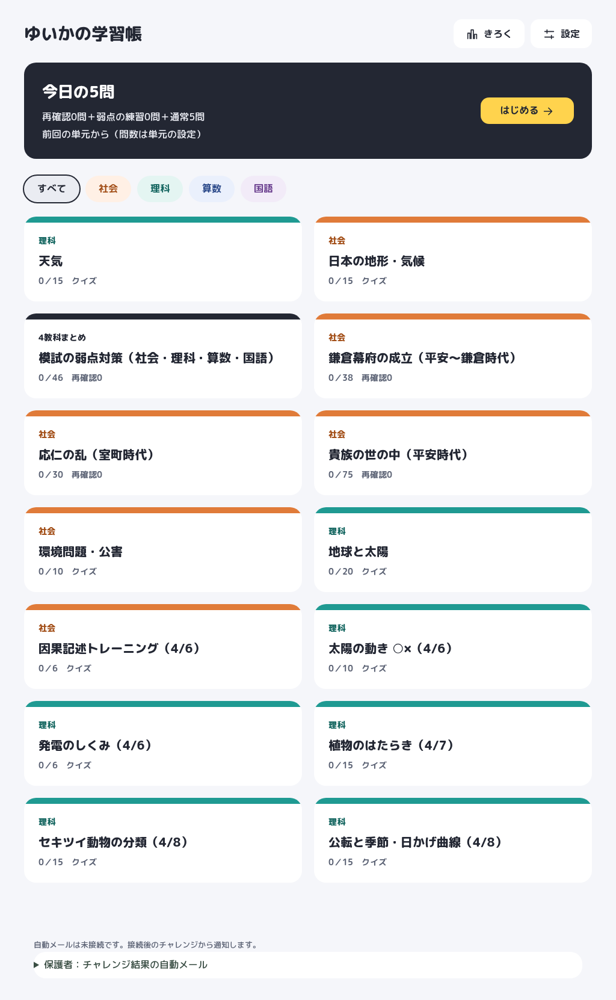
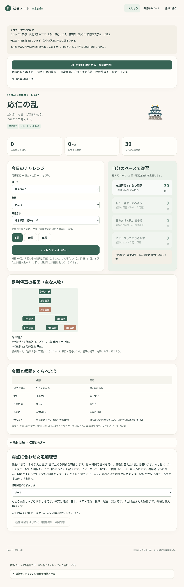
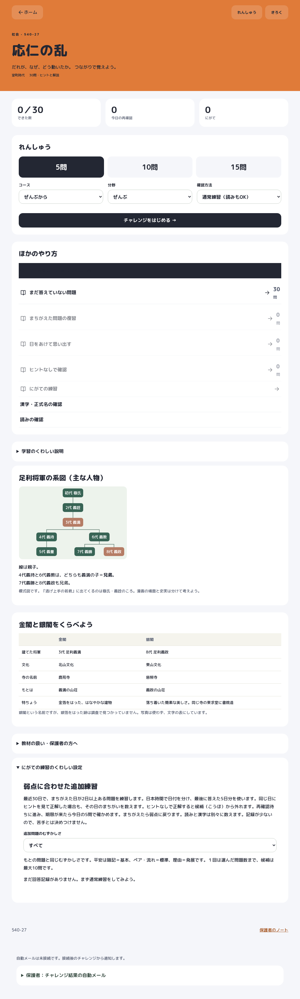
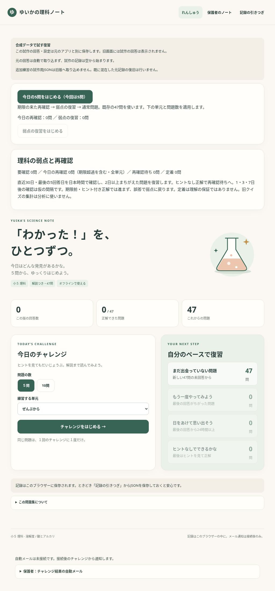
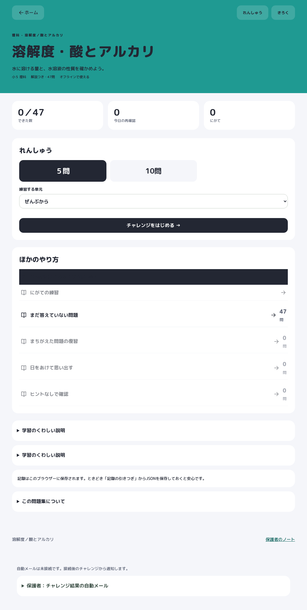
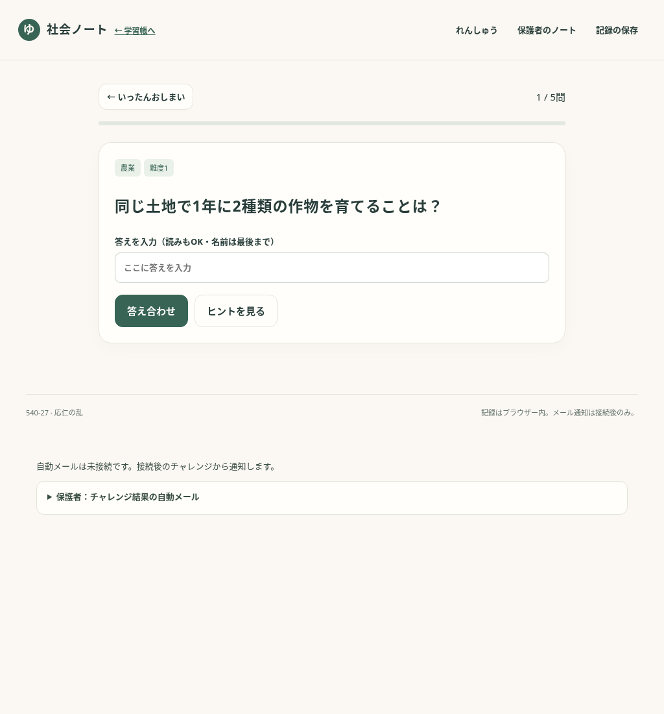
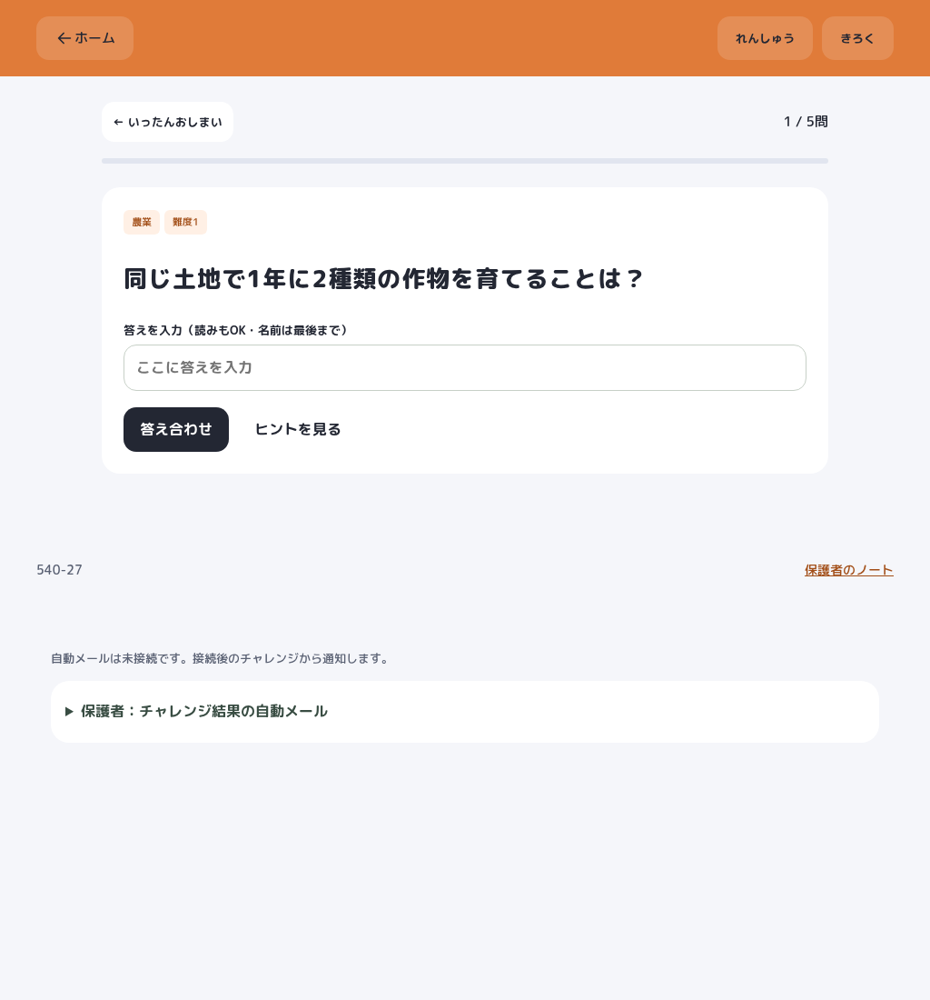

# デザインC（教科カラー）

ホーム内の全14単元カード・10単元の練習画面と、平安・鎌倉・応仁・理科ノート・模試の弱点対策を共通デザインに統一。

- `assets/design.css`：M PLUS Rounded 1c（500/700/800）、色、カード、ヘッダー、ボタン、画面幅への対応。
- `assets/design.js`：線のSVG、教科色、単元ホームの表示部品。既存のボタンとイベント処理を移動して使う。
- `assets/progress.js`：ホーム用の読み取り専用集計。既存の復習判定から生成し、回答・設定を書き込まない。未来日時や読めない記録では数字を断定しない。
- 通知先の入力・保存・接続・送信・再送処理は維持。ホームと通知状態の文章にはメールアドレスを表示しない。
- 開発用の試作説明は「保護者のノート」と記録保存画面に移動。保護者確認モードのバナーは維持。

## 既存機能を守るための表示

問題数は現在の機能を維持する。応仁・鎌倉・模試は5／10／15問、平安・理科ノートは5／10問。ホーム内の旧単元は元の全問クイズと暗記カードを使う。未対応の15問・漢字・読み・再確認の機能は追加しない。旧単元には個別回答からの再確認判定がないため、ホームに直近クイズの点数、単元内に未対応を表す「—」を表示する。

「今日の5問」の移動先・出題数は以前と同じく前回の単元とその保存済み設定に従う。ホームでは既存の判定と同じ再確認・弱点・通常の内訳を表示する。1・3・7日の再確認間隔は既存の仮案を維持する。

社会・理科の色帯上の文字は、読みやすさを確保するため濃色にする。教科ラベルは白背景で指定の濃い文字色を使う。

## 更新手順

質問・復習判定を更新したら `python scripts/design/build_summary.py` でホーム集計を生成する。単元HTMLの生成後は `python scripts/design/embed.py` → `python scripts/parent/embed.py` の順に実行する。新しいページも共通CSS・JSを読み込む。

確認は `bash scripts/check_all.sh`。デザインの検証は390／768／1024pxのChromiumで、全単元の導線、タップ領域、画面内への収まり、メールアドレス非表示、保存内容の保持、単元側との集計一致を確認する。実機iPad・Safari/WebKitの検証は含まない。

## 比較画像

同じmain（`6ec616d`）、1024×1100の新規ブラウザー、通知を遮断するプレビューで撮影。個人の回答や実宛先は使用しない。

| 画面 | 変更前 | 変更後 |
|---|---|---|
| ホーム |  |  |
| 社会・応仁の乱 |  |  |
| 理科ノート |  |  |
| 問題画面 |  |  |
